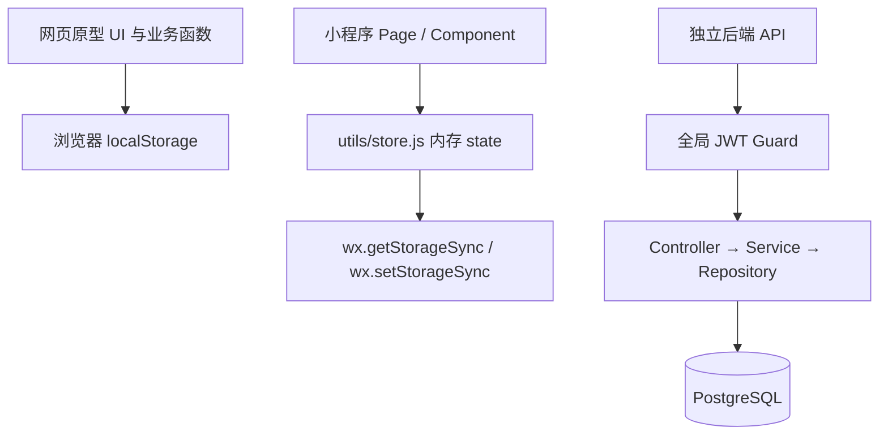

# RestartLife 项目阅读与架构说明

> 阅读日期：2026-10-20。依据当前工作区源码整理，包含尚未提交的改动。本文描述代码现状；设计目标与实际实现不一致时，会单独说明。

## 1. 项目概述

“重启人生计划”是一款以 21 天为周期的习惯打卡应用，同时提供独立的一次性任务清单。核心流程是：设置习惯及目标日 → 每日打卡和记录心得 → 查看日历及统计 → 开始下一轮计划。

仓库包含三个相对独立的部分：

| 部分 | 技术 | 当前定位 |
| --- | --- | --- |
| `prototype/` | 原生 HTML、CSS、JavaScript | 单文件可交互网页原型，使用浏览器本地存储 |
| `miniprogram/` | 微信原生小程序，JS、WXML、WXSS、JSON | 已编写五个页面及项目编辑组件，使用微信本地存储 |
| `server-sample/` | NestJS 10、TypeScript、TypeORM、PostgreSQL | 七个业务模块的后端样例，仍有编译、鉴权和业务完整性问题 |

**当前不是已打通的前后端系统。** 网页和小程序均在本地读写数据，没有调用后端 API；两者存储空间也互不共享。小程序已有 JSON 导入导出入口，可用于手动转移数据。

## 2. 阅读范围与目录

本次阅读覆盖仓库现有源码、页面模板、样式、JSON 配置、依赖声明、TypeScript 配置、`.gitignore` 和三份原有 Markdown 文档。未将 Git 内部对象作为项目源码分析；未安装依赖、连接数据库或启动微信开发者工具。

```text
RestartLife/
├── DESIGN.md                     # 产品、交互、模型及 API 设计目标
├── PROJECT_OVERVIEW.md            # 本文，源码现状与接手说明
├── prototype/
│   └── index.html                # 样式、五页 UI、业务逻辑与数据层
├── miniprogram/
│   ├── app.js                    # onLaunch 初始化 store
│   ├── app.json                  # 页面注册、五个 Tab、窗口配置
│   ├── app.wxss                  # 全局主题和通用样式
│   ├── project.config.json       # 工程配置
│   ├── project.private.config.json # 开发工具本机配置
│   ├── sitemap.json
│   ├── README.md
│   ├── utils/store.js            # 内存状态、本地持久化、业务计算
│   ├── pages/
│   │   ├── today/                # 今日打卡、待办提醒、心得
│   │   ├── tasks/                # 习惯项目管理
│   │   ├── todos/                # 一次性任务
│   │   ├── calendar/             # 21 天日历、详情、补打卡
│   │   └── mine/                 # 统计、计划重置、分享和备份
│   └── components/task-sheet/    # 项目编辑弹层及目标日选择
└── server-sample/
    ├── package.json
    ├── tsconfig.json
    ├── README.md
    └── src/
        ├── main.ts               # Nest 启动、/api、校验管道、CORS
        ├── app.module.ts         # PostgreSQL 连接、模块及全局守卫
        ├── common/               # JWT 守卫、公开路由和当前用户装饰器
        ├── entities/             # User、Plan、Task、CheckIn、DailyNote、Todo
        └── modules/
            ├── auth/
            ├── plans/
            ├── tasks/
            ├── checkins/
            ├── notes/
            ├── stats/
            └── todos/
```

每个小程序页面由 `.js`、`.wxml`、`.wxss`、`.json` 四类文件组成。仓库没有根级包管理配置、自动化测试套件、CI 配置、数据库迁移或容器部署配置，也未发现 AGENTS.md。

## 3. 页面与用户功能

实际 Tab 顺序为 **今日、项目、任务、日历、我的**，以 `miniprogram/app.json` 和网页导航为准。

| 页面 | 已编写的功能 | 主要入口 |
| --- | --- | --- |
| 今日 | 日期和计划天数、进度环、21 天进度点、目标日习惯勾选、带截止日期的未完成任务、心得和五种心情 | `pages/today/today.js` |
| 项目 | 项目列表、完成率、补打卡剩余次数、新增、编辑、删除 | `pages/tasks/tasks.js` |
| 任务 | 未完成／已完成／全部筛选，标题、备注、截止日期，完成切换、编辑和删除 | `pages/todos/todos.js` |
| 日历 | 按周一到周日排列的 21 天日期、完成状态着色、当日详情和心得、历史补打卡 | `pages/calendar/calendar.js` |
| 我的 | 总体完成率、连续及累计打卡天数、项目进度、任务统计、热力图、重置、分享、JSON 备份及导入 | `pages/mine/mine.js` |

日历包含周首占位格，因此并非总是严格的 3 行网格。小程序日期详情显示在页面内的卡片区域，网页原型使用底部弹层。

`task-sheet` 组件提供名称、16 个 emoji、8 种颜色、频率类型及 21 天目标日选择。页面通过 `saved` 和 `close` 事件接收组件操作结果。

主题为米白背景 `#FAFAF7`、绿色主色 `#5B8C5A`、黄色强调 `#E8B04B`，使用白色圆角卡片。网页进度环使用 SVG，小程序使用 `conic-gradient`。

## 4. 架构与数据流



上述客户端与后端之间目前没有请求链路。

小程序启动时 `app.js` 调用 `store.init()`；页面一般在 `onShow()` 查询 store，再通过 `setData()` 渲染。打卡、项目编辑、心得及任务变更直接修改内存状态，并由 `save()` 同步写入本地存储。

网页采用相似业务函数，但数据层、DOM 渲染和事件处理全部放在 `prototype/index.html`。两套业务逻辑是复制维护，已有行为差异，修改时需要分别核对。

后端以业务模块划分：Controller 接收参数，Service 执行业务，TypeORM Repository 访问数据库。全局 `ValidationPipe` 开启白名单、类型转换及拒绝额外字段；但只有实际使用 DTO 类的参数能获得对应字段约束，内联类型和 `Partial<CreateTaskDto>` 等不能视为完整的运行时校验。

## 5. 核心业务规则与实现边界

### 5.1 计划周期

计划开始日计为第 1 天，结束日为开始日加 20 天。统计的已过天数限制在 0～21 天。客户端当天编号展示限制在 1～21，但没有自动把计划状态改成 `completed`。

本地重置前允许独立选择是否保留打卡项目和一次性任务，默认两项均保留。确认后开始日期改为今天，打卡和心得清空；保留项目的 `makeupUsed` 恢复为 0，目标日按新计划天序沿用，保留任务的截止日期和完成状态不变。取消不会修改数据，不保留的列表清空。不会保存旧计划快照。后端提供创建及状态更新接口，没有专门的重置接口或自动到期处理。

### 5.2 习惯频率

| 类型 | 判断方式 |
| --- | --- |
| `daily` | 计划内每天都是目标日 |
| `custom` | `targetDays[dayNumber - 1] === true` 才是目标日 |

小程序首次使用时项目和任务均为空，进入三步新手引导：选择开始日期、勾选习惯及每天／隔天频率、勾选一次性任务。推荐习惯为早睡、早起、运动、阅读，默认不勾选；推荐任务为居家大扫除、去附近的公园散步、看一场美术展、培养一个新爱好。最后确认时一次性创建计划并写入 `onboardingCompleted: true`。未完成引导时下次继续进入引导；已有本地数据但无标记的老用户视为已完成，重置或清空项目不会重新触发。网页原型仍使用原有默认项目。

客户端编辑器禁止点击历史目标日；普通 custom 编辑会合并今天及未来的配置。不过频率切换仍会改变历史计算口径，不能将其视为完善的历史快照机制。后端更新项目直接合并参数，没有同等历史锁定。

### 5.3 打卡和补打卡

客户端今日勾选以 `checkins[date][taskId] = true` 表示完成，取消时删除该键。日历仅向历史目标日的漏打项目显示补打入口，每个项目最多 3 次。

客户端 `canMakeup()` 仅检查历史日期和剩余额度，`doMakeup()` 没有完整校验目标日、计划范围或重复完成，依赖页面控制入口。后端普通 toggle 校验用户、项目和计划范围，但未限制历史日期，也未校验是否目标日；补打接口也未校验目标日。

### 5.4 完成率和连续天数

客户端及后端项目总览的主要口径是：

```text
单项目完成率 = 开始日至今天（最多21天）内已完成目标日数 / 同期目标日数
总体完成率 = 所有有效项目的完成次数之和 / 目标次数之和
当日全部完成 = 当天至少有一个目标项目，且全部目标项目已完成
```

客户端 streak 从今天倒推，每天至少完成一个当前有效项目的目标日打卡即可累计；今天没打卡可跳过，后续空白日中断。累计完成天数也是“至少一次”，并非“当日全部完成”。

后端 streak 和累计天数按 done 记录日期计数，没有同样的目标日过滤；后端热力图分母仍为当前全部有效项目数，与客户端按当天目标项目数计算不同。

### 5.5 一次性任务

Todo 不绑定计划，使用 `completedAt` 是否为空区分完成状态。今日页只展示有截止日期的未完成任务，按截止日升序，逾期任务在前。完整列表支持三态筛选。代码中有置顶字段和操作函数，但客户端模板未提供置顶按钮。

任务截止日期可选；选择时必须大于等于今天、小于等于计划最后一天。网页和小程序均设置选择范围并在保存时校验，小程序数据层也进行校验；计划已结束时不能保存带截止日期的新任务。

## 6. 本地数据结构与备份

网页和小程序主要存储键均为 `restart_life_v3`，但备份对象版本字段为 `v: 4`。小程序导入还额外写入 `restart_life_v4`，日常加载并不读取该键。

| 状态字段 | 内容 |
| --- | --- |
| `plan` | `{ start_date, status }` |
| `tasks` | 习惯项目数组：id、name、icon、color、is_default、sort、frequencyType、targetDays、makeupUsed |
| `checkins` | 按日期、项目 ID 索引的完成布尔值 |
| `notes` | 按日期索引的 `{ content, mood }` |
| `todos` | 一次性任务数组：id、title、note、dueDate、createdAt、completedAt、pinned |
| `editingTaskId` | 临时编辑状态，不属于核心业务数据 |

网页加载时会补齐缺失的 todos；小程序新建状态和旧数据迁移未补齐，见问题清单。v1 迁移将项目设为 daily；v2 weekly 迁移为 custom，根据每周目标数量生成目标日。

客户端导入只做基础结构判断，没有完整校验日期、ID、目标日数组长度和字段类型。小程序初始化时已补齐缺失的 todos 数组。网页完成任务写入 ISO 时间字符串，小程序写入毫秒时间戳，跨端转移时应统一时间类型。

## 7. 后端数据模型

以下以实体属性名为准。当前未配置 snake_case 命名策略，不能直接把 DESIGN.md 中的下划线字段名当作实际数据库列名。

| 实体／表 | 关键字段及关系 |
| --- | --- |
| `User`／users | UUID、nickname、avatarUrl、唯一 email、默认查询不返回的 passwordHash、wxOpenId；关联计划、项目、打卡、心得和 Todo |
| `Plan`／plans | user、startDate、endDate、status、createdAt；关联打卡和心得 |
| `Task`／tasks | user、name、icon、color、sortOrder、isDefault、frequencyType、simple-json targetDays、makeupUsed、isArchived |
| `CheckIn`／checkins | user、plan、task、date、dayNumber、status、completedAt；唯一约束 user + task + date，另有 user + date 索引 |
| `DailyNote`／daily_notes | user、plan、date、dayNumber、content、mood、创建及更新时间；唯一约束 user + plan + date |
| `Todo`／todos | user、title、note、dueDate、pinned、completedAt、createdAt |

Task 属于用户而非计划，目标日及补打次数也保存在 Task 上。若要支持多轮独立计划和稳定历史统计，需要进一步定义项目配置与计划的归属关系。

实体中的关系多配置级联删除。项目删除接口实际使用 `isArchived = true` 软删除；统计只选择当前未归档项目，因此保留了历史记录，并不等于历史统计结果保持不变。CheckIn 实体目前没有设计文档中的 `isMakeup` 字段。

## 8. API 清单（当前 Controller）

所有路径带 `/api` 前缀。除注册、邮箱登录和微信登录外，路由均经过全局 JWT 守卫。以下表示路由已声明，不代表接口已完成运行验证。

| 模块 | 方法及路径 | 主要输入／用途 |
| --- | --- | --- |
| 认证 | `POST /api/auth/register` | nickname、email、password |
| 认证 | `POST /api/auth/login` | email、password |
| 认证 | `POST /api/auth/wx-login` | code；内部换取 openid 尚未实现 |
| 认证 | `GET /api/auth/me` | 当前用户 |
| 计划 | `POST /api/plans` | 可选 startDate；首次创建初始化默认项目 |
| 计划 | `GET /api/plans/current` | 当前 active 计划 |
| 计划 | `GET /api/plans/:id` | 指定计划 |
| 计划 | `PATCH /api/plans/:id` | status |
| 项目 | `GET /api/tasks` | 未归档项目 |
| 项目 | `POST /api/tasks` | name、icon、可选 color、frequencyType、targetDays |
| 项目 | `PATCH /api/tasks/:id` | 更新项目 |
| 项目 | `DELETE /api/tasks/:id` | 归档项目 |
| 项目 | `POST /api/tasks/reorder` | `{ orders: [{ id, sortOrder }] }` |
| 打卡 | `GET /api/checkins?date=YYYY-MM-DD` | 某天记录，返回数组 |
| 打卡 | `GET /api/checkins/range?from=...&to=...` | 日期范围 |
| 打卡 | `POST /api/checkins/toggle` | `{ taskId, date }` |
| 打卡 | `POST /api/checkins/makeup` | `{ taskId, date }` |
| 心得 | `GET /api/notes/:date` | 查询心得 |
| 心得 | `POST /api/notes` | date、content、可选 mood，查找后创建或更新 |
| 统计 | `GET /api/stats/overview` | 完成次数、比率、连续及累计天数 |
| 统计 | `GET /api/stats/by-task` | 各项目进度 |
| 统计 | `GET /api/stats/heatmap?planId=...` | 21 天热力图，可选 planId |
| 任务 | `GET /api/todos?showDone=true` | true 返回全部，默认仅未完成 |
| 任务 | `POST /api/todos` | title、可选 note、dueDate |
| 任务 | `PATCH /api/todos/:id` | 编辑任务 |
| 任务 | `POST /api/todos/:id/toggle` | 完成状态切换 |
| 任务 | `POST /api/todos/:id/pin` | 置顶切换 |
| 任务 | `DELETE /api/todos/:id` | 删除任务 |

与原设计的差异：排序为 POST 而非 PATCH；范围查询有独立 `/range`；参数使用 taskId、planId 等驼峰名称；未实现 `/api/plans/:id/progress`。

## 9. 运行与开发方式

### 网页原型

直接用浏览器打开 `prototype/index.html` 即可查看原型，无需构建和后端。剪贴板写入失败时，代码使用 prompt 提供复制兜底。数据存储于当前浏览器环境。

### 微信小程序

用微信开发者工具导入 `miniprogram/`，检查 AppID 和本机基础库配置后编译预览。该目录无需 npm 安装。公共配置声明基础库 3.4.0，私有配置为 3.17.4；实际本机行为需在开发工具中确认。公共配置已填写具体 AppID，并非原 README 所述 touristappid。

首次进入任务页缺少 todos 的初始化错误已修复；尚未进行微信开发工具全功能验收。

### 后端样例

需要 Node.js、npm 和可连接的 PostgreSQL 数据库。仓库未声明 engines 或固定 Node 版本，也未提供依赖锁文件。

```powershell
cd F:\VibeCoding\RestartLife\server-sample
npm install
$env:DB_HOST = 'localhost'
$env:DB_PORT = '5432'
$env:DB_USER = 'postgres'
$env:DB_PASSWORD = '<数据库密码>'
$env:DB_NAME = 'restart_life'
$env:JWT_SECRET = '<本地开发密钥>'
$env:PORT = '3000'
npm run build
npm run start:dev
```

数据库需要预先创建。源码直接读取 `process.env`，没有 dotenv 或 ConfigModule 加载逻辑，因此仅创建 `.env` 文件不会自动生效。默认端口是 3000，表结构配置为 `synchronize: true`。后端当前有下述静态检查发现的阻塞项，以上是预期启动流程，并非已验证成功的启动结果。

声明的 npm 脚本为 start、start:dev、build、lint。lint 调用 eslint，但 package.json 未声明 ESLint 依赖，仓库也未提供对应配置或 test 脚本。

## 10. 已发现的问题与待完善项

### 10.1 已用隔离 Node 调用复现

以下检查以模拟 wx 存储在内存执行，没有修改实际用户数据：

| 问题 | 复现及影响 | 位置 |
| --- | --- | --- |
| 小程序缺少初始 todos（已修复） | 初始化时补齐 todos 数组，空存储可以新增任务；已用隔离 Node 调用验证 | `miniprogram/utils/store.js` 的 init |
| 选择心情覆盖心得正文（已修复） | setNote 仅在 content 非 undefined 时更新正文；今日心得增加保存按钮，保留自动保存，已验证切换心情、清空文字及按钮保存 | `pages/today/today.js` 的 onMood、onSaveNote 与 `utils/store.js` 的 setNote |

### 10.2 源码检查发现，尚未在完整运行环境验证

| 优先级 | 问题 | 位置／处理方向 |
| --- | --- | --- |
| 高 | 缺少 Passport JWT strategy 的实现与注册；Guard 使用 `AuthGuard('jwt')`，受保护接口无法形成完整鉴权链路 | auth 模块需补充验证 token、读取 sub、生成当前用户 id 的策略 |
| 高 | 严格 TypeScript 配置下存在类型不一致：例如给非空 Date/string 属性赋 null、可能为空的环境变量转换、默认项目频率被推断为普通 string | checkins、notes、plans 服务及 app.module；需要实际 build 核对完整报错 |
| 高 | 多处查询未加载 task 关系，却读取 `r.task.id` 或 `c.task.id`；实体未配置 eager | checkins、stats 服务，显式加载关系或返回 relation ID |
| 高 | Todo 查询手写 `t.user_id`、`t.completed_at`，与当前未设置下划线命名策略的实体不一致 | todos.service.ts，统一实体属性和数据库列名 |
| 中 | Todo.user 的反向关系指向 `u.tasks`，而 User 已定义 todos | todo.entity.ts，应核对 ORM 关系元数据 |
| 中 | 普通打卡可绕过补打配额改历史，且未校验目标日；补打也缺少目标日和归档检查 | checkins.service.ts，集中实现打卡规则 |
| 中 | 补打遇到已有 pending 记录时创建新实体，可能触发 user/task/date 唯一约束；记录写入与额度更新不在事务内 | checkins.service.ts，更新已有记录并保证原子性 |
| 中 | 频率切换、新增 daily 项目和删除项目会重算历史分母，偏离“新增仅影响未来／历史保持”目标 | 两端 store 与后端 tasks、stats，需引入生效时间或计划快照 |
| 中 | 重置计划不恢复补打额度；目标日配置随项目跨轮复用 | 客户端 resetPlan、后端 Task/Plan 建模 |
| 中 | 后端热力图、连续天数和累计天数口径与客户端不同 | stats.service.ts |
| 中 | 小程序 Todo 排序比较器部分分支返回 0，正反比较不对称，也未实现完整“未完成优先”规则 | store.js 的 listTodos |
| 中 | 导入版本及存储键不统一，字段校验不足，缺少异常存储数据归一化 | mine.js、store.js、网页 load/doImport |
| 低 | 日历补打成功后只刷新详情，没有调用 renderCal，网格颜色可能保持旧状态 | calendar.js 的 onMakeup |
| 低 | 日历及目标日选择器的占位格仍绑定点击事件，没有空格保护 | calendar.wxml、task-sheet.wxml 及事件处理 |
| 低 | 项目页 planInfo 未赋值；任务截止日边界未赋值的问题已修复 | tasks.js 与相应模板 |
| 低 | 原型中用户输入直接拼入 innerHTML，且图标背景生成 `rgb(...)19`，不是有效颜色格式 | prototype/index.html 的列表渲染及 hexLight |
| 低 | 界面提示“长按拖动排序”，但网页未实现相应拖拽逻辑；客户端未暴露置顶操作 | 原型、Todo 模板 |

### 10.3 现有说明与源码不一致

- DESIGN.md 和小程序 README 仍有“四个 Tab／独立 stats 页”的描述；实际为五个 Tab，统计在 mine 页。
- 小程序 README 将重置入口放在项目页，实际在我的页。
- 后端 README 表示 auth/plans/notes 仍需补全，但这些模块已有实现；其中鉴权链路和微信登录仍不完整。
- 后端 README 将 toggle 描述为 upsert，实际为查询后 save，不能据此认为已处理并发冲突。
- DESIGN.md 重复列出了 checkins 表，且部分字段、接口方法和参数名称已与实体及 Controller 不同。

## 11. 后续开发建议

1. 先修复小程序初始化和心得丢失，使本地核心流程稳定，并统一存储版本及导入归一化。
2. 明确历史不变、计划到期、重置额度、频率切换及一次性任务截止日是否受计划限制等业务规则。
3. 修复后端编译、JWT 策略、关系查询、列名及补打事务，验证 PostgreSQL 上的完整请求链路。
4. 为日期边界、迁移、计划重置、目标日统计、打卡唯一性和额度并发增加有针对性的测试。
5. 接入小程序请求层、登录态、失败提示和同步策略；现有同步 store 调用需要相应调整，不能只机械替换 load/save。
6. 完善数据库迁移、配置校验、依赖锁定及部署流程，再同步更新原有文档。

## 12. 本次交付与验证边界

后续更新：小程序新手引导频率支持每天、隔天、自定义。自定义展示计划内 21 天日期，可逐日勾选；已选习惯至少选择一个目标日才能继续，切换频率保留临时选择，调整开始日期后日期标签随之更新。

本次仅新增本文档，保留已有工作区改动。已完成全项目文件阅读、接口与模型交叉核对，以及两项内存级数据层问题复现。未运行依赖安装、后端构建、数据库集成测试、浏览器交互验收或微信真机预览；其余问题标记为源码检查结论，后续应在对应环境验证。
